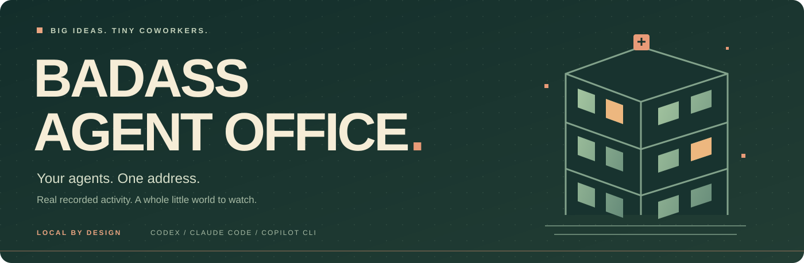
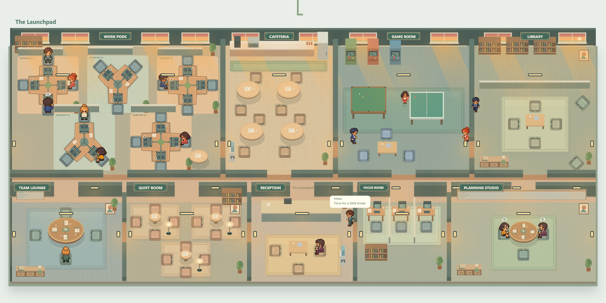

<div align="center">



**A pixel office for the AI agents building your next big thing.**

Codex · Claude Code · Copilot CLI

[Get started](#open-the-office) · [Take a tour](#a-little-world-for-your-work) · [How it works](#real-agents-real-signals) · [Development](#under-the-hood)

</div>

---

Your agents are shipping code, planning features, and waiting for your next move. Give them a place you can actually see.

**Badass Agent Office** turns recorded local agent activity into a living pixel workspace. Your projects get floors. Your sessions get tiny coworkers. You get one place to see who's working, who needs you, and what just finished.

All in your browser. All running on your computer.



<p align="center"><sub>Actual game canvas and original worker sprites. Illustrative demo workers; no personal session data.</sub></p>

## Open the office

### Download. Extract. Double-click.

1. At the top of this repository, click **Code → Download ZIP**.
2. **Extract the ZIP** into a folder on your computer.
3. Open that folder and double-click **`Open Agent Office.cmd`**.
4. Your browser opens at **http://127.0.0.1:4317/**.

**The `.cmd` file is the Windows launcher. You don't need to type commands into a terminal.** Keep it in the extracted project folder with the other files.

The launcher starts the local server in the background. If Node.js is missing, it offers to install it through winget. Agent Office requires **Node.js 24 or later**; you can also install it from [nodejs.org](https://nodejs.org/), then double-click the launcher again.

> **First visit?** An empty building is normal. Click **Configure** to add your first project floor.

<details>
<summary><strong>On macOS or Linux?</strong></summary>

The `.cmd` launcher is for Windows. With Node.js 24 or later installed, download and extract the repository, open a terminal in its folder, and run:

```sh
npm start
```

Visit http://127.0.0.1:4317/. Press `Ctrl+C` in that terminal to stop the server. The app has no third-party runtime dependencies; an install step isn't needed to launch it.

</details>

## Make it yours

Click **Configure** in the top bar:

1. **Name your office.** Give the building its own identity.
2. **Add a logo.** Optional PNG, JPEG, or WebP, up to 512 KB.
3. **Add a floor.** Paste an absolute path to a local project folder and choose a floor name.
4. **Save building.** Start a supported agent in that project and watch its worker arrive.

Your settings and logo live in `.agent-office/config.json`, which Git ignores. Fresh installations have no personal project roster. You can rename or remove floors anytime; removing a floor never deletes your project files or session records.

Nested folders and linked Git worktrees share their main project's floor. Duplicate and overlapping project folders are rejected.

## A little world for your work

| Your building | Your view |
| :--- | :--- |
| **One continuous map** | Drag across project floors, zoom into the action, or select a project to move the camera straight there. |
| **Tiny coworkers, proper desks** | Workers have stable workstations, reserved seats, and routes around furniture. Recorded planning brings them to the Planning Studio. |
| **The Boss room** | A building-wide report of sessions, activity, input requests, and pending team reports. |
| **Updates that wait for you** | Completion markers show unread updates. Inspect workers or acknowledge a floor when you're ready. |
| **A place to breathe** | A cafeteria, game room, library, quiet room, and lounge bring the office to life between turns. |
| **Set the mood** | Choose Cozy, Fresh, or Night. Make the building feel like yours. |

**Explore:** drag to pan · scroll or use **+/−** to zoom · **Fit** to recenter · click a worker to inspect · click a room to learn its purpose.

## Real agents. Real signals.

The observer reads supported local session records. It doesn't infer work from an open window.

| Provider | Observe local activity | Start tasks from the office |
| :--- | :---: | :---: |
| **Codex** | ✓ | ✓ |
| **Claude Code** | ✓ | ✓ |
| **Copilot CLI** | ✓ | — |

Use your normal terminal or IDE workflow. VS Code and other IDE sessions appear when their agents write the same supported local records. Unsupported chat windows, remote-only sessions, and providers without readable local records aren't automatically detected.

- **Recent means recent.** Only sessions with recorded activity in the last **six hours** get floor workers. Earlier records can appear in the people list without returning expired workers to the map.
- **Quiet stays unknown.** Missing or stale signals aren't presented as active work.
- **Relationships come from records.** Parent/child connections reflect recorded relationships. Spawned workers inherit their parent's project floor.
- **Discovery takes a moment.** New sessions may take about **15 seconds** to appear; existing records refresh every **two seconds**.

> **The pixels have personality. The status has evidence.** Walking, coffee breaks, games, and short scripted dialogue are decorative. Inspect a worker for its separately displayed recorded status, task title, and activity labels.

## Give your floor a mission

Select a project and click **Create task**. Choose **Codex** or **Claude Code**, optionally set a model and thinking effort, write your instruction, and press **Send task**.

Tasks start only after you press Send. They use the selected provider's installed local CLI and existing login. **Review only** is the default; allowing edits inside the project is an explicit choice. Replies appear in the task panel, and supported completed office tasks accept follow-up messages.

These are separate tasks. Existing conversations in other apps stay controlled there. The office doesn't request an API key; tasks use the provider's normal connection and account billing. Stopping an office task stops that run.

## Your computer. Your office.

The dashboard server binds to **`127.0.0.1`** and accepts local hostnames only. Session data stays on this computer. The observer reads session records without modifying them and excludes reasoning, transcript bodies, tool arguments, command output, and credentials from its responses.

Configuration writes and task submissions require origin and token checks. Task requests validate the project, send prompts through stdin, and use bounded permission modes. Office-run replies stay in server memory until it stops.

Share the source so other people can run their own offices locally. Keep personal configuration, provider records, logs, and environment files out of Git.

<details>
<summary><strong>Troubleshooting & everyday questions</strong></summary>

| What happened? | What to do |
| :--- | :--- |
| **The launcher won't start** | Check that Node.js 24 or later is installed, extract the ZIP fully, and keep the launcher beside `server.mjs`. Check `office-error.log` in the project folder. |
| **Node.js is too old** | Install Node.js 24 or later from [nodejs.org](https://nodejs.org/) and reopen the launcher. |
| **The office is empty** | Click **Configure**, add the correct project folder, and run a supported agent there. Workers need activity within the last six hours. |
| **An agent hasn't appeared yet** | Allow about 15 seconds for discovery. Confirm it writes supported records locally and belongs to a configured project. |
| **The port is busy** | The office may already be running. Open http://127.0.0.1:4317/. The Windows launcher uses port 4317. |
| **Task creation is unavailable** | Install and sign in to the selected provider's CLI. Its executable must be discoverable or configured explicitly. |
| **I changed source files** | Refresh your browser. Restart the local server for server-side changes. |
| **Does closing the tab stop it?** | No. The Windows launcher runs the server in the background; reopening it reuses the running office. To stop it, end only this folder's `node server.mjs` process listening on port 4317. |

</details>

## Under the hood

**Node.js 24+ · native HTTP server · browser canvas · original pixel sprites**

There are no third-party runtime dependencies. The optional native canvas package is a development dependency for visual checks.

```sh
npm ci
npm test
```

Render the actual game canvas and sprites without a browser:

```sh
node scripts/render-preview.mjs
```

This local preview reads your configured office and writes to the ignored `output/` folder. To regenerate the README image using **only synthetic demo data**:

```sh
node scripts/render-readme.mjs
```

<details>
<summary><strong>Local environment options</strong></summary>

| Variable | Purpose |
| :--- | :--- |
| `AGENT_OFFICE_PORT` | Server port when starting manually; defaults to `4317`. The Windows launcher uses `4317`. |
| `AGENT_OFFICE_CONFIG` | Alternate local settings file. |
| `AGENT_OFFICE_CODEX_HOME` | Alternate Codex data folder. |
| `AGENT_OFFICE_CLAUDE_HOME` | Alternate Claude projects folder. |
| `AGENT_OFFICE_COPILOT_HOME` | Alternate Copilot session-state folder. |
| `AGENT_OFFICE_CODEX_BIN` | Explicit Codex executable path. |
| `AGENT_OFFICE_CLAUDE_BIN` | Explicit Claude Code executable path. |

For a manual development server, run `npm start`. In PowerShell, use `npm.cmd start` if script execution policy blocks `npm.ps1`.

</details>

See [README.txt](README.txt) for detailed room, animation, navigation, and activity notes. See [the sprite guide](public/assets/README.md) for atlas layouts and animation frames.

---

<div align="center">

**Big ideas. Tiny coworkers. Badass office.**

[MIT licensed](LICENSE) · Built to run locally · Make yourself at home

</div>
